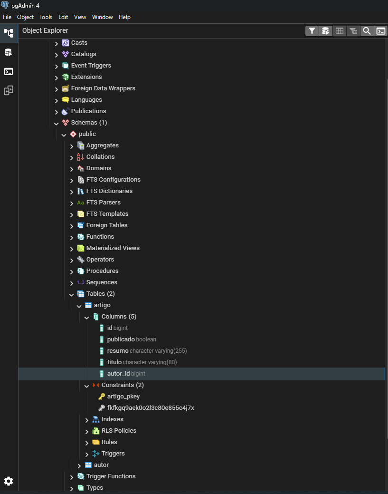

Integrantes: Rhaynan Oliveira Antunes
             Luiz Gabriel Merotto De Lima
             Gabriel Eduardo Beck Paes

## Visão Geral

A API da Editora é um serviço RESTful desenvolvido com Spring Boot 4.1.1 e PostgreSQL para gerenciamento de autores e artigos em um sistema editorial. A aplicação disponibiliza operações completas de CRUD e gerencia o relacionamento 1:N entre autores e artigos, implementando regras de negócio como validação e unicidade de e-mail de autores, vinculação obrigatória de autor na criação de artigos (`autorId`), busca textual de artigos por título, listagem por status de publicação e integridade referencial que impede a exclusão de autores com artigos vinculados.

## Como executar

Requisitos: Java 17+, PostgreSQL com o banco `editora` criado e a senha ajustada em `src/main/resources/application.properties`.

```bash
./mvnw spring-boot:run   # sobe em http://localhost:8000/editora
```

API em produção: https://editora-api.onrender.com/editora

## Endpoints da API

Base URL local: `http://localhost:8000/editora`  
Base URL em produção: `https://editora-api.onrender.com/editora`  
*(CORS liberado para qualquer origem)*

> **Nota:** As rotas de artigos ficam direto na raiz da base URL, por exemplo `GET /editora/` e `GET /editora/{id}`.

| Método | Caminho | Descrição | Status Possíveis |
|---|---|---|---|
| `GET` | `/api/autores` | Lista todos os autores cadastrados | `200 OK` |
| `GET` | `/api/autores/{id}` | Busca um autor pelo seu ID | `200 OK`, `404 Not Found` |
| `GET` | `/api/autores/{id}/artigos` | Lista todos os artigos de um autor específico | `200 OK`, `404 Not Found` |
| `POST` | `/api/autores` | Cadastra um novo autor (`nome` e `email` obrigatórios; e-mail deve ser único) | `201 Created`, `400 Bad Request`, `409 Conflict`, `500 Internal Server Error` |
| `DELETE` | `/api/autores/{id}` | Remove um autor pelo ID (impede exclusão se o autor possuir artigos vinculados) | `204 No Content`, `404 Not Found`, `409 Conflict`, `500 Internal Server Error` |
| `GET` | `/` | Lista todos os artigos; aceita parâmetro de busca parcial `?titulo=` (case-insensitive) | `200 OK`, `204 No Content` (vazio), `500 Internal Server Error` |
| `GET` | `/{id}` | Busca um artigo pelo seu ID | `200 OK`, `404 Not Found` |
| `GET` | `/publicado` | Lista todos os artigos marcados como publicados (`publicado = true`) | `200 OK`, `204 No Content` (vazio), `500 Internal Server Error` |
| `POST` | `/` | Cria um novo artigo vinculado obrigatoriamente a um autor existente (`autorId`) | `201 Created`, `400 Bad Request`, `404 Not Found`, `500 Internal Server Error` |
| `PUT` | `/{id}` | Atualiza os dados de um artigo existente e opcionalmente seu autor vinculado | `200 OK`, `404 Not Found` |
| `DELETE` | `/{id}` | Remove um artigo pelo seu ID | `204 No Content`, `500 Internal Server Error` |
| `DELETE` | `/` | Remove todos os artigos cadastrados | `204 No Content`, `500 Internal Server Error` |

## Exemplos de JSON

### Autores

#### Requisição (`POST /api/autores`)
```json
{
  "nome": "Clarice Lispector",
  "email": "clarice@exemplo.com",
  "biografia": "Escritora e jornalista brasileira, autora de romances e contos consagrados."
}
```

#### Resposta (`GET /api/autores/{id}` ou `POST /api/autores`)
```json
{
  "id": 1,
  "nome": "Clarice Lispector",
  "email": "clarice@exemplo.com",
  "biografia": "Escritora e jornalista brasileira, autora de romances e contos consagrados.",
  "artigos": []
}
```

---

### Artigos

#### Requisição (`POST /` ou `PUT /{id}`)
```json
{
  "titulo": "A Hora da Estrela",
  "resumo": "A trajetória da jovem alagoana Macabéa no Rio de Janeiro.",
  "publicado": true,
  "autorId": 1
}
```

#### Resposta (`GET /{id}`, `POST /` ou `PUT /{id}`)
```json
{
  "id": 1,
  "titulo": "A Hora da Estrela",
  "resumo": "A trajetória da jovem alagoana Macabéa no Rio de Janeiro.",
  "publicado": true,
  "autor": {
    "id": 1,
    "nome": "Clarice Lispector",
    "email": "clarice@exemplo.com",
    "biografia": "Escritora e jornalista brasileira, autora de romances e contos consagrados."
  }
}
```

## Modelo de dados


